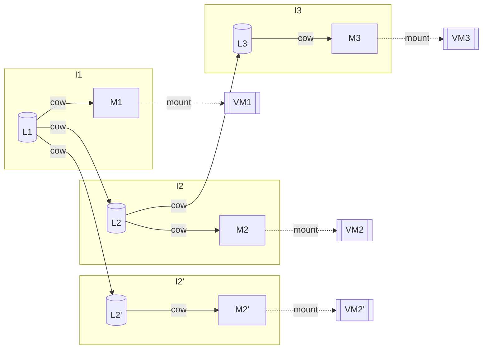

# Architecture

This document briefly outlines the architecture of `Hyper`.

## Layers and Images

Each layer acts as a COW block device on top of another layer. Three types of
layers exist:

  - **Base layers** are layers which are _immutable_, and require no parent
    layer to represent the full state of an immutable _image_.
  - **Intermediate layers** are _immutable_ layers which record the difference
    state between two states. As an example, if `L1` is a base layer, and `L2`
    is an intermediate layer on top of it, the composition of these two layers
    is a block device containing state of taking `L1` and applying the writes
    in `L2`.
  - **Mutable layers** are ephemeral layers which support writes, and may, or
    may not be converted into **intermediate layers**.

An image is defined as a chain of layers. For an image to be legal, the first
layer in the chain **must** be a base layer. There may be an arbitrary number
of intermediate layers. A **mutable image** is an image in which the last
layer is a **mutable layer**.

Think of an image as a **layer stack**, the same model as Docker/OCI image
layers: start from a base layer and apply each intermediate layer's diff on
top, in order. The stack `B → L1 → L2` is the image you get by applying `L1` to
`B`, then `L2` to that result. Attaching a mutable layer on top makes the stack
writable.

<details>
<summary>Formal definition</summary>

Layer application is associative, so layers compose into an image recursively:

$$
I_i = \begin{cases}
B & i = 0 \\
I_{i-1} \cdot L_i & \text{ else}
\end{cases}
$$

</details>

This mechanism supports mounting mutable images `I` into VMs. The value add of
doing this fragmented, COW-style operations is twofold:

  - We significantly reduce the amount of memory necessary to store each image
    by only really storing the diffs between each layer.
  - We significantly speed up the forking operation.

A helpful illustration of layers and images is given here, as well as how they
are mounted into VMs:



### Storage

Hyper expects your layers and images to be stored in a shared pool filesystem.
This filesystem must contain images `I.img`, `L.img`, etc. The directory
structure of this filesystem follows that of a flat directory structure, so you
can back this with any of [NFS](https://wiki.archlinux.org/title/NFS), [S3
Files](https://aws.amazon.com/s3/features/files/),
[Archil](https://archil.com/), [Mesa](https://mesa.dev/) or any other
filesystem. The author uses the local filesystem for debugging, and NFS for
production use. This medium is referred to as the **layer storage medium**.

A side-car PostgreSQL database stores:

  - The dependency relationships between each individual layer and image.
  - Leases issued out to virtual machines to track which layers are currently
    considered active.

The aforementioned PostgreSQL database is coined the **metadata database**.

### Composition

Composing layers and images is a surprisingly non-trivial task and we describe
here how it has been achieved. When attempting to compose a chain of layers
`[:b, :l1, :l2, :m]` where `:b` refers to the base layer, `:l*` refer to
intermediate layers and `:m` refers to the mutable layer, `Hyper` employs the
following strategy:

  1. The base layer, `B.img` is first mounted as a loopback block device via
     `losetup`. This results in a `/dev/loop*` block device, call it
     `/dev/loopB`.
  2. All intermediate layers, `L1.img`, `L2.img` are mounted as loopback block
     devices into `/dev/loopL1`, `/dev/loopL2`.
  3. The image `I` containing `[:b, :l1, :l2]` (but not `:m`), is composed
     through `dm-snapshot`. This results in a `/dev/mapper` block device, call
     it `/dev/mapper/I`.
  4. Finally, a mutable layer `:m` is attached on top of `/dev/mapper/I` via
     `dm-thin`. This creates a mutable layer on top of the `I` image, which can
     be given to firecracker to run the VM.

## Nodes

`Hyper` is designed as a distributed system, which allows you to add compute to
the cluster, on-demand. As your workload increases, `Hyper` allows you to add
more nodes. `Hyper` itself, currently, does not add additional nodes, but will
automatically distribute workloads across your cluster, as required.

## VM Specs

Virtual machines have a spec that they are identified with. Each machine has a
set of pre-configured specs defined in `Hyper.Vm.Instance.specs` that describe
the absolute maximum limits that the given machine can have. For example, the
base image has the following spec:

```elixir
base: %Spec{
  vcpus: 4,
  mem: Information.mib(2048),
  disk: Information.gib(32),
  disk_bw: Bandwidth.mibps(256),
  net_bw: Bandwidth.mibps(128)
}
```

The configurable values are:

| Value     | Description |
|-----------|-------------|
| `vcpus`   | A fractional value of how many CPU cores a machine may consume. Note that this is potentially a value less than `1`, as we can allocate fractions of a CPU's scheduling time |
| `mem`     | The absolute maximum RAM a machine can allocate. |
| `disk`    | The absolute maximum disk usage a machine can use. |
| `disk_bw` | The absolute maximum disk bandwidth a machine can use. |
| `net_bw`  | The absolute maximum network bandwidth a machine use. |

### Budgets

Each node offers its resources to VMs under two kinds of budget, split by what
happens when the node runs out:

  - **Reserved (hard) resources** — `mem` and `disk`. These are
    *incompressible*: a VM that cannot get the memory or disk it was promised
    can crash. Every VM reserves its full spec up front, and a node never
    reserves more than its capacity (`mem_max`, `disk_max`).
  - **Shared (soft) resources** — `vcpus`, `disk_bw` and `net_bw`. These are
    *compressible*: when the node runs short, every VM on it slows down but
    keeps running. Nothing is reserved; instead, the node measures its live
    load and refuses new VMs once it is too busy.

> #### Kubernetes comparison {: .info}
>
> If you know Kubernetes: reserved resources behave like memory requests, shared
> resources like CPU, which can be throttled without killing anything.
>
> | Value     | Budget   | Running out means                   |
> |-----------|----------|-------------------------------------|
> | `vcpus`   | shared   | All VMs on the node slow down.      |
> | `mem`     | reserved | VMs may crash.                      |
> | `disk`    | reserved | VMs may crash.                      |
> | `disk_bw` | shared   | Disk is slower for all VMs.         |
> | `net_bw`  | shared   | Network is slower for all VMs.      |

#### Reserved: free capacity

A node's **free** memory (or disk) is its capacity minus what running VMs have
reserved. For example, a node with `mem_max` of 16 GiB running three VMs of
4 GiB each has 4 GiB free: a 4 GiB VM fits, a 6 GiB VM does not.

<details>
<summary>Formal definition</summary>

For a reserved metric $m$ (memory or disk) on node $N$:

$$
\text{free}_m(N) = \text{capacity}_m(N) - \sum_{\texttt{VM} \text{ on } N} \text{spec}_m(\texttt{VM})
$$

</details>

#### Shared: busy threshold

Shared resources cannot be predicted from a spec, since a VM may sit idle or
saturate its share. So the node measures its live load (smoothed over recent
samples) and applies a **busy threshold**, a fraction of capacity set by the
`*_max_load` keys. A VM fits only if the node's current load plus the VM's
spec stays at or under that threshold. With the default `0.8`, the rule reads:
_don't place a VM that would push this node past 80% busy_.

  - CPU load is a fraction of the whole machine, and a VM's demand is its
    `vcpus` divided by the node's core count.
  - Bandwidth thresholds are the configured capacity (`disk_bw_cap`,
    `net_bw_cap`) times the busy threshold.

<details>
<summary>Formal definition</summary>

For a shared metric $m$, with live load $\text{load}_m(N)$ and busy threshold
$k_m$ (<code>*_max_load</code>):

$$
\text{load}_m(N) + \text{spec}_m(\texttt{VM}) \le k_m \cdot \text{capacity}_m(N)
$$

</details>

> #### No overcommit ratio {: .warning}
>
> Hyper does not yet support an **overcommit ratio**, that is, reserving shared
> resources from specs and letting the total reach some multiple of capacity.
> Shared resources are governed by live load alone.

## Scheduling

The process of deciding which node runs a VM is called **scheduling**. It has
two phases: **filter** out nodes that cannot take the VM, then **score** the
ones left and pick the best.

### Filter

Each node gossips a snapshot of its budget to the cluster. The scheduler keeps
a node only if, according to that snapshot, the VM:

  1. **fits** its reserved budget: the VM's `mem` and `disk` are each at or
     under the node's free memory and disk, and
  2. keeps the node **under its busy threshold** for CPU, disk bandwidth and
     network bandwidth.

<details>
<summary>Formal definition</summary>

Over the set of cluster nodes $\mathcal{N}$:

$$
\text{fits}(\mathcal{N}, \texttt{VM}) = \left\lbrace
N \in \mathcal{N} :
\bigwedge_{m \in \text{reserved}} \text{spec}_m(\texttt{VM}) \le \text{free}_m(N)
\right\rbrace
$$

$$
\text{candidates}(\mathcal{N}, \texttt{VM}) = \left\lbrace
N \in \text{fits}(\mathcal{N}, \texttt{VM}) :
\bigwedge_{m \in \text{shared}} \text{load}_m(N) + \text{spec}_m(\texttt{VM}) \le k_m \cdot \text{capacity}_m(N)
\right\rbrace
$$

</details>

### Score: layer locality

Layer storage is far larger, and far slower, than the NVMe drives on each node.
A node that already has a VM's layers mounted skips downloading them, so the
scheduler prefers it. Each candidate gets a **layer locality score**: the
number of bytes of the VM's image that are already mounted on that node.

> A further optimization, as it turns out, exists -- colocation can be improved
> not only by spawning VMs on nodes that have layers mounted, but by also
> colocating VMs on nodes which have _recently_ had the required layers
> mounted.
>
> At current, a layer is considered mounted if the layers are all mounted as
> block devices. The net result is that even though a block device is umounted
> (and by proxy -- `Hyper` believes the layer is not locally available), the
> shared layer medium may cache the data itself, which could be useful to
> speed up bootup.
>
> It is worth noting that in this document, the author hand-waves what
> "caching a layer" means -- many network-attached media cache at the block
> layer, so in certain cases it is more valuable to ask "how much of an image
> is cached".
>
> This is considered a future improvement.

<details>
<summary>Formal definition</summary>

Let $\Lambda(\texttt{VM})$ be the set of layers in the VM's image,
$\text{mnt}(N)$ the set of layers mounted on node $N$, and $|L|$ the size of
layer $L$ in bytes:

$$
\text{locality}(N, \texttt{VM}) = \sum_{L \in \Lambda(\texttt{VM}) \cap \text{mnt}(N)} |L|
$$

Candidates are tried in descending order of this score.

</details>

### Strategy

In total, the scheduling strategy is:

  1. Keep the nodes with enough free memory and disk for the VM.
  2. Of those, keep the nodes the VM would not push past their busy threshold.
  3. Sort them by layer locality score, highest first.
  4. Ask each node in turn to run the VM. The node re-checks its budget against
     its live state, since the gossiped snapshot may be stale, and the first one
     to accept wins.

## Forking

Forking clones a running VM's disk at a point in time. Two paths exist:

  - **Fast fork** (`Hyper.Vm.fast_fork/1`) — guaranteed colocation. The
    parent's mutable `dm-thin` volume is suspended for an instant while the
    node's thin pool takes an *internal snapshot* (`create_snap`), then
    resumed. The child activates the snapshot against the same composed
    read-only image origin and boots fresh. No bytes are copied; parent and
    child share pool blocks copy-on-write. If the node refuses admission
    (memory, disk, or load), fast fork errors gracefully.

  - **Fork** (`Hyper.Vm.fork/1`) — fast fork first; on local refusal the
    parent's divergence is *materialized*: a temporary thin snapshot's
    provisioned ranges — read from the pool's own metadata, and with an
    external origin exactly the blocks ever written — are copied into a fresh
    `dm-snapshot` exception store, which is published to the layer storage
    medium as an intermediate (`:delta`) layer and recorded as a derived image
    (the parent's chain plus the new layer). The child is then scheduled
    normally; layer locality scoring prefers nodes that already hold the parent's
    base layers, so only the delta travels.

Both paths are **disk-only**: the child cold-boots a fresh kernel over the
forked rootfs. The snapshot is crash-consistent (the guest is asked to `sync`
best-effort first). Memory-state forking via Firecracker snapshots is future
work.
