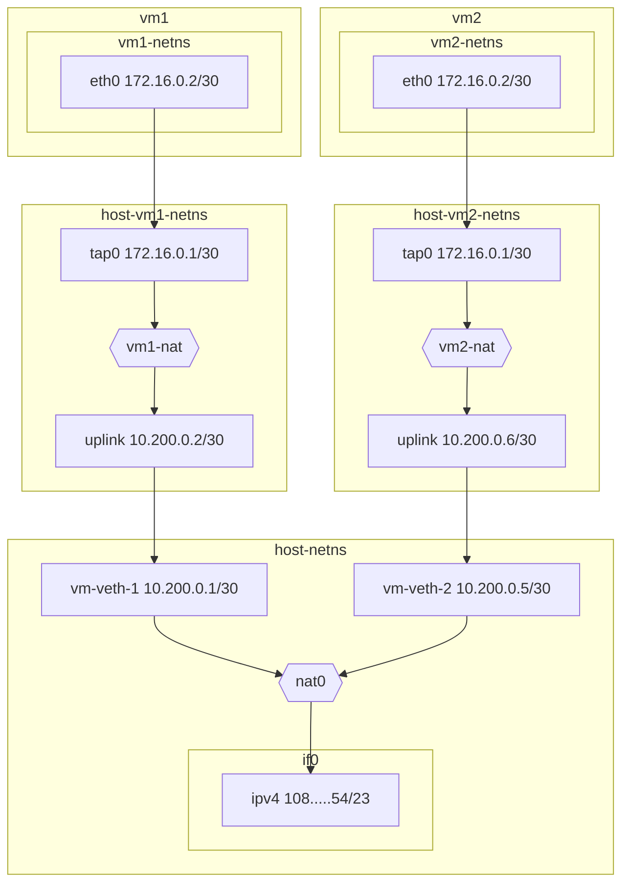

# Networking

This document serves to document and illustrate networking in Hyper. This
document assumes you are relatively familiar with high-level networking
concepts. I have done my best to provide useful links for new and unfamiliar
terms.

## Goals

TODO

## Architecture Overview

### VM Namespaces

Hyper allocates a single [network
namespace](https://man7.org/linux/man-pages/man7/network_namespaces.7.html) per
guest VM. The host has its own _host namespace_.

Namespaces isolate each VM from the host: a compromised firecracker process can
neither see the host's network devices nor reach services listening on the
host's `localhost`.

## Outgoing IPv4

IPv4 traffic on hyper is outbound only.

For outgoing [IPv4](https://en.wikipedia.org/wiki/IPv4) traffic, Hyper
allocates a single ingress
[NAT](https://en.wikipedia.org/wiki/Network_address_translation) per hypervisor
node in the host namespace. Hyper uses
[`nftables`](https://en.wikipedia.org/wiki/Nftables) to configure the NAT.

Namespaces are connected through
[veth](https://man7.org/linux/man-pages/man4/veth.4.html) devices. Alongside
creating a namespace per VM, Hyper creates a veth pair. One side of the pair
goes in the host namespace, and the other goes in the VM's namespace.

The veth domain is specified to be `10.200.0.0/16`. This allows for `16,384`
possible veth pairs. Each host side of the veth pair gets a `10.200.X.1+4*Y`
address, while the namespace side gets a `10.200.X.2+4*Y` address. For example:

| Slot  | Subnet            | vm-veth        | uplink         |
|-------|-------------------|----------------|----------------|
| 0     | 10.200.0.0/30     | 10.200.0.1     | 10.200.0.2     |
| 1     | 10.200.0.4/30     | 10.200.0.5     | 10.200.0.6     |
| 64    | 10.200.1.0/30     | 10.200.1.1     | 10.200.1.2     |
| 16383 | 10.200.255.252/30 | 10.200.255.253 | 10.200.255.254 |

> #### Unavailable addresses {: .info}
>
> Please note that the `10.200.X.0+4*Y/30` and `10.200.X.3+4*Y/30` addresses
> are unavailable for use. The former represents the subnet address and the
> latter is the broadcast address, as per IP spec.

An additional NAT is added in the VM's namespace so that every guest sees the
same IPv4 configuration: `eth0` is always `172.16.0.2/30`, with `172.16.0.1` as
its gateway. The namespace NAT translates that shared address to the
namespace's unique `uplink` address before traffic reaches the host, which is
what lets the host tell VMs apart.

> #### Uniform guest configuration {: .info}
>
> Because every guest's IPv4 configuration is identical, it never has to be
> rewritten per VM. A VM restored from a memory snapshot, whose network
> configuration is frozen in guest memory, would come up with working IPv4
> without any re-addressing step.

Finally, a [TAP](https://en.wikipedia.org/wiki/TUN/TAP) network device connects
the VM's namespace to the firecracker VM. TAP is the only network backend
firecracker supports.

## Bidirectional IPv6

## FAQ

This section aims to answer some commonly-asked questions.

### Why not reverse HTTP proxy?

One of my goals with Hyper is to be able to support arbitrary
protocols---`ssh`, `quic`, `tcp`, `udp` and pretty much anything on top of
[IP](https://en.wikipedia.org/wiki/Internet_Protocol). If Hyper used a reverse
HTTP proxy, we would only be able to support HTTP and websockets, which implies
all the aforementioned protocols would not be supported.

### Why is IPv4 outbound only?

Each node has a single public IPv4 address. Often enough, cloud providers may
not even provide a singular IPv4 adress due to how scarce IPv4 is. For inbound
traffic, Hyper supports IPv6.
