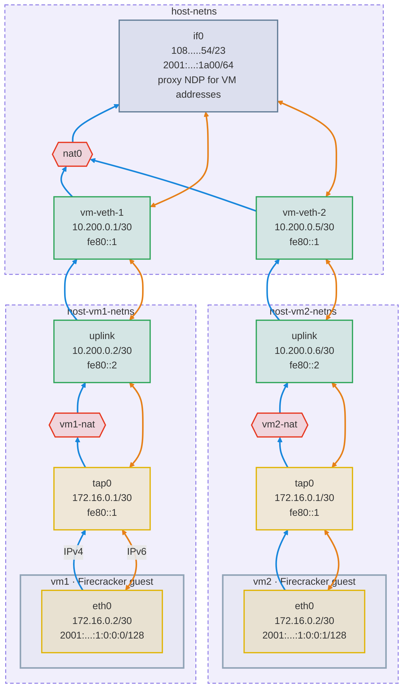
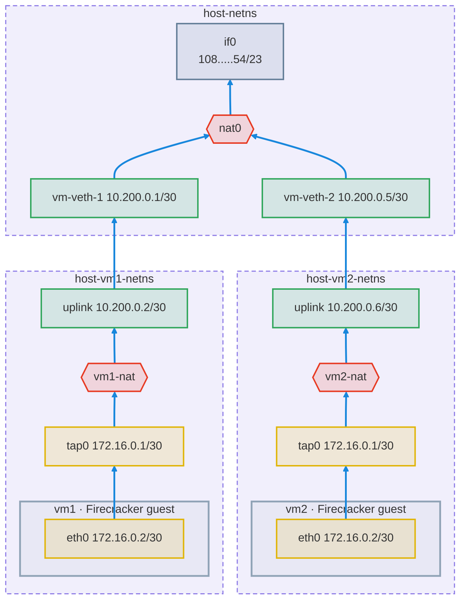
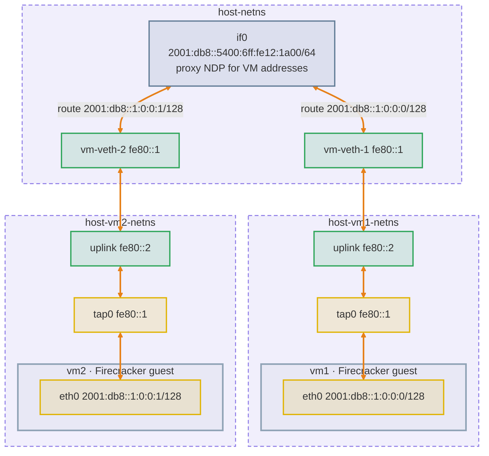

# Networking

This document serves to document and illustrate networking in Hyper. This
document assumes you are relatively familiar with high-level networking
concepts. I have done my best to provide useful links for new and unfamiliar
terms.

## Goals

Hyper's networking is designed to make a VM feel like a real machine on the
internet.

- **Any protocol**: Hyper must support any IP-based protocol. This enables
  `ssh`, `http`, `udp`, `tcp`, `quic`, whatever!
- **Reachable**: VMs must be reachable from the public internet.
- **Isolated**: VMs cannot reach any of the host's services, nor other VMs
  directly.
- **Hostable**: Hypervisors need to be hostable on most cloud providers.
- **Secure**: Hyper's networking needs to be secure out-of-the-box.

### Security

There are two malicious actors that Hyper aims to protect against. A malicious
VM should never impact any other VM nor the hypervisor itself.

The external internet is considered antagonistically and Hyper aims to protect
against external malactors.

The goals for Hyper are:

- VMs cannot open connections to any host address. Hyper handles this by
  confining VMs to isolated namespaces and firewalls.
- VMs cannot connect to infrastructure providers. Hyper enables this via
  explicit inbound and outbound firewall rules.
- VMs should not be able to reach other VMs within the hypervisor. VMs which
  try to talk to other VMs over the public IPs are intended to successfully do
  so, but directly talking is not allowed.
- VMs should be banned from running some ports. Hyper achieves this through its
  firewall rules.
- VMs have all inbound ports blocked, unless the operator (you) opens ports.
- VMs have a default set of outbound ports blocked, unless explicitly permitted
  by the operator.
- VMs can only send traffic from their own addresses. Forged IP addresses are
  dropped.

## Architecture Overview

Both address families share the same `eth0`, `tap0` and veth devices.

### VM Namespaces

Hyper allocates a single [network
namespace](https://man7.org/linux/man-pages/man7/network_namespaces.7.html) per
guest VM. The host has its own _host namespace_.

Namespaces isolate each VM from the host: a compromised firecracker process can
neither see the host's network devices nor reach services listening on the
host's `localhost`.

## Outgoing IPv4

IPv4 traffic on hyper is outbound only.

For outgoing [IPv4](https://en.wikipedia.org/wiki/IPv4) traffic, Hyper
allocates a single ingress
[NAT](https://en.wikipedia.org/wiki/Network_address_translation) per hypervisor
node in the host namespace. Hyper uses
[`nftables`](https://en.wikipedia.org/wiki/Nftables) to configure the NAT.

Namespaces are connected through
[veth](https://man7.org/linux/man-pages/man4/veth.4.html) devices. Alongside
creating a namespace per VM, Hyper creates a veth pair. One side of the pair
goes in the host namespace, and the other goes in the VM's namespace.

The veth domain is specified to be `10.200.0.0/16`. This allows for `16,384`
possible veth pairs. Each host side of the veth pair gets a `10.200.X.1+4*Y`
address, while the namespace side gets a `10.200.X.2+4*Y` address. For example:

| Slot  | Subnet            | vm-veth        | uplink         |
|-------|-------------------|----------------|----------------|
| 0     | 10.200.0.0/30     | 10.200.0.1     | 10.200.0.2     |
| 1     | 10.200.0.4/30     | 10.200.0.5     | 10.200.0.6     |
| 64    | 10.200.1.0/30     | 10.200.1.1     | 10.200.1.2     |
| 16383 | 10.200.255.252/30 | 10.200.255.253 | 10.200.255.254 |

> #### Unavailable addresses {: .info}
>
> Please note that the `10.200.X.0+4*Y/30` and `10.200.X.3+4*Y/30` addresses
> are unavailable for use. The former represents the subnet address and the
> latter is the broadcast address, as per IP spec.

An additional NAT is added in the VM's namespace so that every guest sees the
same IPv4 configuration: `eth0` is always `172.16.0.2/30`, with `172.16.0.1` as
its gateway. The namespace NAT translates that shared address to the
namespace's unique `uplink` address before traffic reaches the host, which is
what lets the host tell VMs apart.

> #### Uniform guest configuration {: .info}
>
> Because every guest's IPv4 configuration is identical, it never has to be
> rewritten per VM. A VM restored from a memory snapshot, whose network
> configuration is frozen in guest memory, would come up with working IPv4
> without any re-addressing step.

Finally, a [TAP](https://en.wikipedia.org/wiki/TUN/TAP) network device connects
the VM's namespace to the firecracker VM. TAP is the only network backend
firecracker supports.

## Bidirectional IPv6

Unlike IPv4, every VM gets its own globally routable
[IPv6](https://en.wikipedia.org/wiki/IPv6) address, reachable in both
directions. I expect users to prefer this route.

### Addressing

Each hypervisor node owns an IPv6 **prefix**. Hyper reserves the
`<prefix>:1::/80` sub-range for VMs. A VM in slot `N` gets
`<prefix>:1:0:0:N/128`:

| Slot  | VM address              |
|-------|-------------------------|
| 0     | `2001:db8::1:0:0:0`     |
| 1     | `2001:db8::1:0:0:1`     |
| 64    | `2001:db8::1:0:0:40`    |
| 16383 | `2001:db8::1:0:0:3fff`  |

> #### Hardcoded Addresses {: .info}
>
> Note that at the time of writing, Hyper expects the whole sub-range
> `<prefix>:1::/80` to be available. Most cloud providers provide at least a
> `/64` prefix, so this is more than fine.

### Outbound

The guest's `eth0` holds its `/128` with a default route via `fe80::1`, which
is `tap0`. The VM's namespace forwards the packet out of `uplink` to its
default route, `fe80::1` on `vm-veth-N`.

### Inbound

From the perspective of the external network (ie. internet), Hyper presents VMs
as on-link hosts. The internet should not need to know/care about the
specifics of the hypervisor networking.

The external network (ie. your cloud provider's router) queries the
hypervisor's `/64` segment: _"Which MAC address holds this IPv6 address?"_.
This is done via the
[NDP](https://en.wikipedia.org/wiki/Neighbor_Discovery_Protocol), which is
IPv6's equivalent to
[ARP](https://en.wikipedia.org/wiki/Address_Resolution_Protocol).

Hyper hosts an [ND Proxy (RFC 4389)](https://www.rfc-editor.org/info/rfc4389/)
on the hypervisor to answer this question. When the upstream link solicits a
VM-specific IPv6 address, the ND Proxy on the hypervisor's NDP proxy responds
with its own MAC address, routing all VM-specific IP traffic to the hypervisor
itself. The kernels IP tables then internally route to the appropriate VM's
virtual interface.

## Firewalls

TODO

Do not forget about default firewall rules.

## FAQ

This section aims to answer some commonly-asked questions.

### Why not reverse HTTP proxy?

One of my goals with Hyper is to be able to support arbitrary
protocols—`ssh`, `quic`, `tcp`, `udp` and pretty much anything on top of
[IP](https://en.wikipedia.org/wiki/Internet_Protocol). If Hyper used a reverse
HTTP proxy, we would only be able to support HTTP and websockets, which implies
all the aforementioned protocols would not be supported.

### Why is IPv4 outbound only?

Each node has a single public IPv4 address. Often enough, cloud providers may
not even provide a singular IPv4 adress due to how scarce IPv4 is. For inbound
traffic, Hyper supports IPv6.
