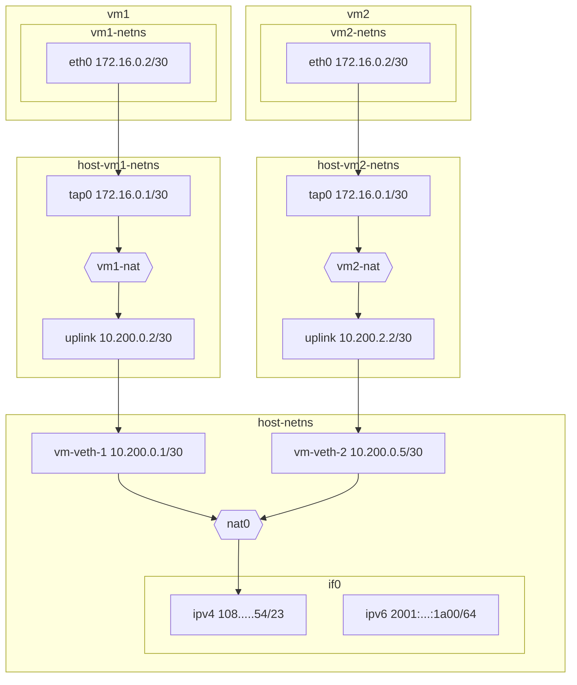
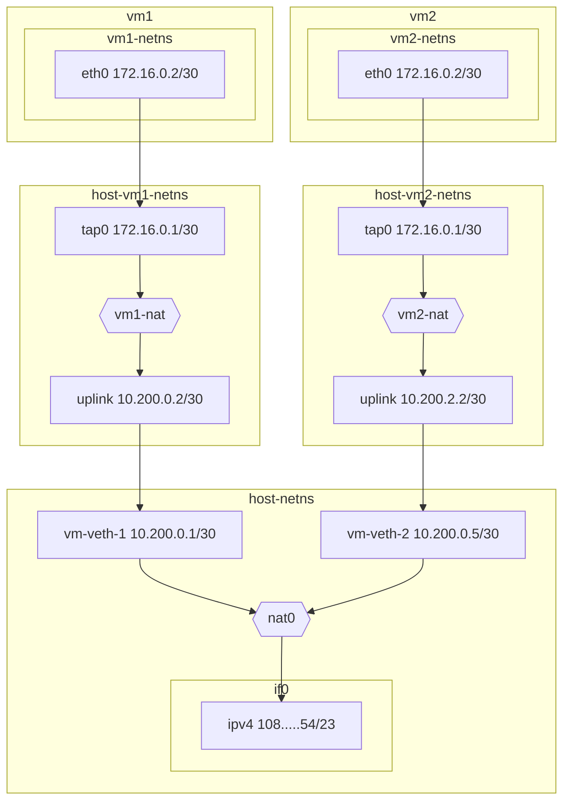

# Networking

This document serves to document and illustrate networking in Hyper. This
document assumes you are relatively familiar with high-level networking
concepts. I have done my best to provide useful links for new and unfamiliar
terms.

## Goals

TODO

## Architecture Overview

### VM Namespaces

Hyper allocates a single [network
namespace](https://man7.org/linux/man-pages/man7/network_namespaces.7.html) per
guest VM. The host has its own _host namespace_.

Namespaces serve to provide isolation per VMs. Namespaces prevent access to the
host's network devices as well as services running on `localhost` for
compromised firecracker instances.

## Outgoing IPv4

For outgoing [IPv4](https://en.wikipedia.org/wiki/IPv4) traffic, Hyper
allocates a single host
[NAT](https://en.wikipedia.org/wiki/Network_address_translation) per hypervisor
node in the host namespace. Hyper uses
[`nftables`](https://en.wikipedia.org/wiki/Nftables) to configure the NAT.

Namespaces are bridged through
[veth](https://man7.org/linux/man-pages/man4/veth.4.html) devices. Alongside
creating a namespace per VM, Hyper creates an IPv4 veth pair. One side of the
pair goes in the host namespace, and the other goes in the VM's namespace.

The veth domain is specified to be `10.200.0.0/16`. This allows for `16,384`
possible veth pairs. Each host side of the veth pair gets a `10.200.X.1+4*Y`
address, while the namespace side gets a `10.200.X.2+4*Y` address. For example:

| VM    | Subnet            | vm-veth        | uplink         |
|-------|-------------------|----------------|----------------|
| 1     | 10.200.0.0/30     | 10.200.0.1     | 10.200.0.2     |
| 2     | 10.200.0.4/30     | 10.200.0.5     | 10.200.0.6     |
| 64    | 10.200.1.0/30     | 10.200.1.1     | 10.200.0.2     |
| 16383 | 10.200.255.252/30 | 10.200.255.253 | 10.200.255.254 |

> #### Unavailable addresses {: .info}
>
> Please note that the `10.200.X.0+4*Y/30` and `100.200.X.3+4*Y/30` addresses
> are unavailable for use. The former represents the subnet address and the
> latter is the broadcast address, as per IP spec.
>
> These addresses are effectively useless.

An additional NAT is added in the VM's namespace with the express goal of
ensuring that the VM-local IP remains stable across VM pauses and restarts.

> #### Stable IPs {: .info}
>
> Stable IPs are useful. VMs may be configured to host services on a stable IP
> and if the IP changes from under the VM user, the user may find such behavior
> unexpected.

Finally, a [TAP](https://en.wikipedia.org/wiki/TUN/TAP) network device is used
to bridge into the firecracker VM. This is the only way we can add interfaces
into firecracker.

## FAQ

This section aims to answer some commonly-asked questions.

### Why not reverse HTTP proxy?

One of my goals with Hyper is to be able to support arbitrary
protocols---`ssh`, `quic`, `tcp`, `udp` and pretty much anything on top of
[IP](https://en.wikipedia.org/wiki/Internet_Protocol). If Hyper used a reverse
HTTP proxy, we would only be able to support HTTP and websockets, which implies
all the aforemnetioned protocols would not be supported.
